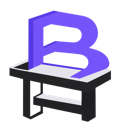
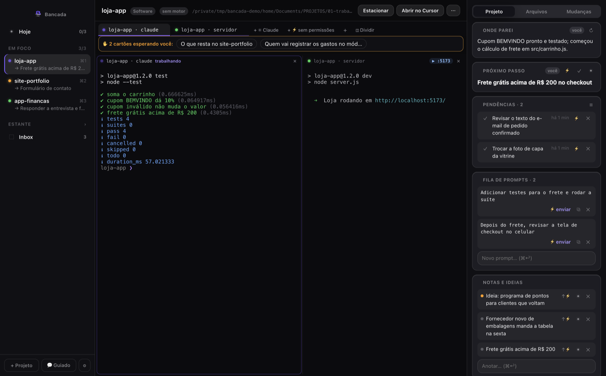
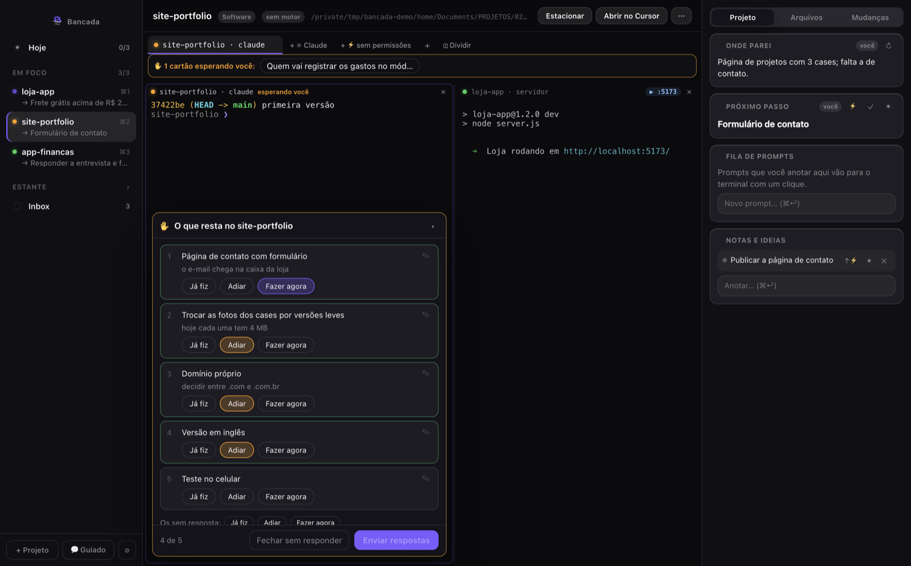
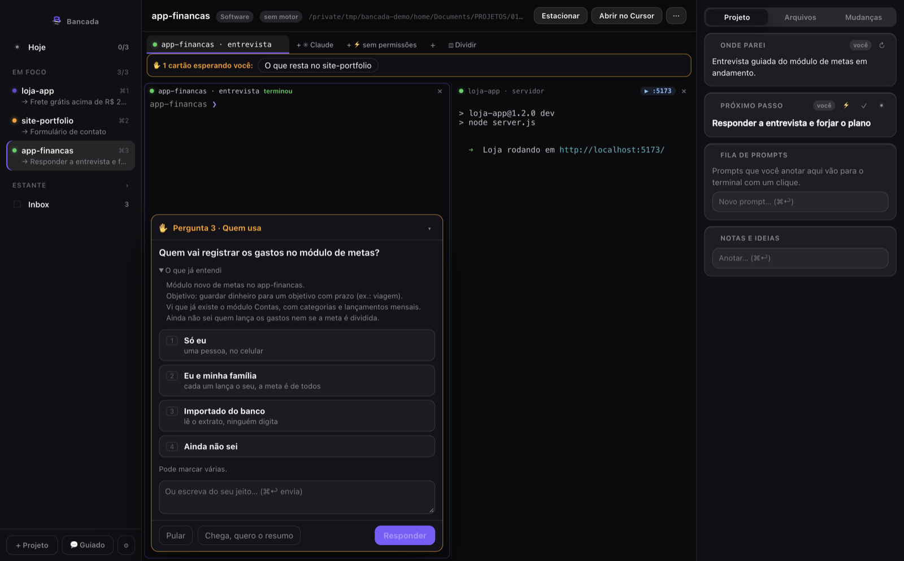
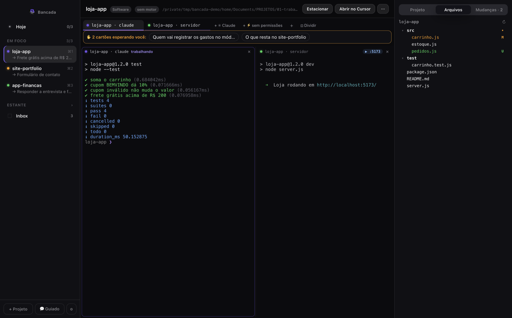
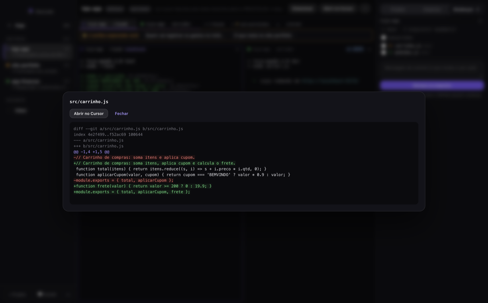
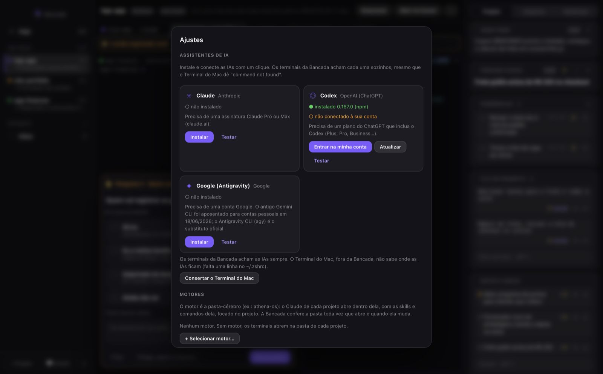
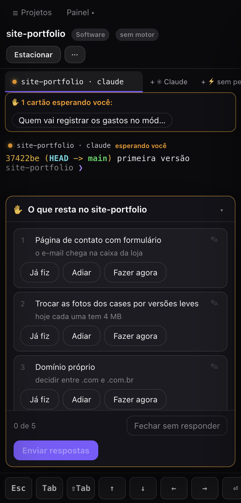
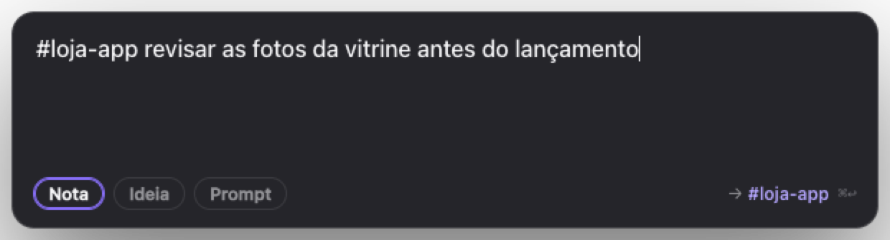

<div align="center">



# Bancada

**Os seus terminais de IA, organizados por projeto — e você nunca perde onde parou.**

App de Mac para quem programa com Claude Code, Codex e outras IAs no terminal: cada projeto tem seus terminais,
a Bancada mostra qual IA está trabalhando, qual está esperando você e qual terminou — e quando a IA precisa de
uma decisão, você responde por botões, no Mac ou no celular.




</div>

---

> **A Bancada é a evolução do PromptPad.** O PromptPad era um bloco de captura de prompts (⌥Space → escreve → fila).
> A Bancada mantém a captura rápida e as notas — e importa o `notes.json` do PromptPad sem perder nada — mas virou
> o lugar onde você trabalha com as IAs.

## O que ela faz

### Projetos e terminais
- **Foco e estante** — poucos projetos em foco, o resto na estante. Cada projeto com seus terminais (xterm + node-pty).
- **Onde parei / próximo passo** — lê as sessões do Claude e do Codex (só leitura, incremental) e resume em uma linha o que estava sendo feito em cada projeto.
- **Hoje** (no máximo 3 coisas) e **Inbox** para o que ainda não tem projeto; **Estacionar** guarda um projeto na estante com o registro de onde parou.
- **Painel do projeto** — onde parei, próximo passo, pendências, fila de prompts, notas e ideias, sessões recentes e comandos do motor.
- **Divisão de tela** — arraste uma aba para a lateral: até 4 painéis, de projetos diferentes, redimensionáveis, com o layout salvo.
- **Painel do projeto** — abas **Arquivos** (árvore com marcação git) e **Mudanças** (git status, diff, commit dos selecionados; nunca faz push). Arrastar um arquivo para o terminal cola o caminho.
- **Imagens para o Claude** — cole ou arraste uma imagem no terminal e ela vai como arquivo.
- **Medidor de contexto** por conversa e **prévia do localhost** em janela própria.

### Estado de cada IA
- Bolinha na aba e no projeto: **trabalhando**, **esperando você** (âmbar), **terminou**, **esperando tarefa em segundo plano**.
- Funciona por hooks do Claude Code passados com `--settings` — somam-se aos seus, nada no seu projeto é alterado.
- Aviso do macOS (e no celular) quando uma IA precisa de você; clicar leva direto ao terminal.

### Responder por botões (v0.4)
- **Cartões dentro do painel do terminal.** O Claude da Bancada ganha três ferramentas (servidor MCP próprio, sem dependências):
  - `lista` — "o que resta?" vira uma lista em que cada item é marcado com um toque: **Já fiz / Adiar / Fazer agora**, com nota opcional;
  - `perguntar` — uma pergunta por vez, com opções clicáveis (teclas 1–6), texto livre, **Pular** e **Chega, quero o resumo**;
  - `pendencias` — o que você marcou "Adiar" vira pendência do projeto, num cartão próprio.
<table>
<tr>
<td></td>
<td></td>
</tr>
<tr><td align="center"><sub>"O que resta?" vira uma lista para marcar</sub></td><td align="center"><sub>Entrevista guiada: uma pergunta por vez</sub></td></tr>
</table>

- **💬 Novo projeto guiado** — uma entrevista estilo Akinator (`/bancada:entrevista`): cada pergunta nasce da resposta anterior, e no fim sai um resumo que qualquer pessoa conseguiria construir.

<table>
<tr>
<td></td>
<td></td>
</tr>
<tr><td align="center"><sub>Arquivos: árvore com marcação do git</sub></td><td align="center"><sub>Mudanças: diff e commit local</sub></td></tr>
</table>

### Assistentes de IA
- Tela **Ajustes → Assistentes de IA**: instalar, entrar, atualizar e testar Claude Code, Codex e Google (agy) pelos instaladores oficiais, sem `sudo`. Conserta o `PATH` do Terminal do Mac com backup.
- **Motores**: se você tem uma pasta-cérebro (com `CLAUDE.md`, comandos e skills), o Claude de cada projeto roda dentro dela, focado no projeto. Sem motor, ele abre na pasta do projeto.



### Celular e iPad
- **Acesso remoto só pelo Tailscale** — nada na rede local, nada na internet. Pareamento por QR de uso único, token por aparelho, Host/Origin conferidos.
- Terminais, estados e cartões de pergunta funcionam no celular.



### Captura rápida (herança do PromptPad)
- **⌥Space** de qualquer lugar → anote uma nota, ideia ou prompt. `#projeto texto` cai direto no projeto.
- Resumo da manhã com as coisas de Hoje. Lembretes com hora vindos do PromptPad continuam avisando na hora (criar um lembrete com hora pela Bancada ainda não existe).



## Instalar

Requer macOS em Apple Silicon e Node.js 20+ para compilar.

```bash
git clone https://github.com/Deckoso/bancada.git
cd bancada
npm install          # compila node-pty e better-sqlite3 para o Electron
npm test             # testes unitários
npm run install-app  # gera, assina localmente (ad-hoc) e instala em /Applications/Bancada.app
```

O app tem assinatura local, não notarizada pela Apple. Na primeira abertura, use **botão direito → Abrir**.
Para passar a Bancada para outra pessoa: `npm run share` gera um `.zip` — veja [docs/PASSAR-A-BANCADA.md](docs/PASSAR-A-BANCADA.md).

## Como usar

O guia completo, com todas as funções, prints e atalhos, está em **[docs/BANCADA-USO.md](docs/BANCADA-USO.md)**. O caminho mais curto:

1. **Primeira abertura:** marque os projetos que a Bancada achou em `~/Documentos/PROJETOS/<categoria>/<projeto>` e escolha até 3 em foco (ou use **+ Projeto** para qualquer pasta).
2. **Conecte uma IA:** Ajustes → Assistentes de IA → **Instalar** e **Entrar na minha conta**.
3. **Abra um Claude** no projeto (**+ ✳︎ Claude**) e trabalhe normalmente. A bolinha mostra quando ele está trabalhando, esperando você ou terminou.
4. **Pergunte "o que resta?"** e marque a lista pelos botões; o que você adiar vira pendência.
5. **Comece algo novo com 💬 Guiado:** a IA te entrevista e no fim entrega um resumo pronto para construir.
6. **Celular:** Ajustes → Acesso remoto → Parear aparelho, com o Tailscale ligado nos dois.

| Atalho | Ação |
|---|---|
| ⌥Space | Anotar de qualquer app (`#projeto texto` manda direto para o projeto) |
| ⌘1 … ⌘5 | Projeto em foco |
| ⌘J | Hoje |
| ⌘T | Novo terminal |
| ⌘\\ | Dividir a tela |

## Privacidade e segurança

- **Tudo local.** Banco SQLite em `~/Library/Application Support/Bancada/`. Nenhuma telemetria.
- A ponte de perguntas não abre porta: pedidos e respostas são arquivos em pastas `0700` do seu usuário.
- Uma resposta de cartão só é colada no terminal se o Claude ainda estiver em primeiro plano nele (nunca num shell).
- Fechar um terminal ou o app encerra a sessão inteira do pty — nada fica rodando escondido.

## Arquitetura

```
app/
├── main/        # processo principal (Electron): pty, banco, hooks, sessões, ponte MCP, acesso remoto
│   ├── mcp-server.js   # servidor MCP (lista / perguntar / pendencias), roda no binário da Bancada
│   └── asks.js         # recebe os pedidos e entrega as respostas dos cartões
├── preload/     # ponte segura renderer ↔ main
├── renderer/    # interface (HTML/CSS/JS, sem framework) + versão celular
└── plugin/      # plugin do Claude Code com /bancada:entrevista
test/unit/       # node:test, rodando no próprio Electron
```

## Licença

[MIT](LICENSE)
