<div align="center">

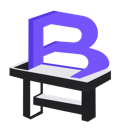

# Bancada

**Os seus terminais de IA, organizados por projeto — e você nunca perde onde parou.**

App de Mac e Windows para quem programa com Claude Code, Codex e outras IAs no terminal: cada projeto tem seus terminais,
a Bancada mostra qual IA está trabalhando, qual está esperando você e qual terminou — e quando a IA precisa de
uma decisão, você responde por botões, no Mac ou no celular.


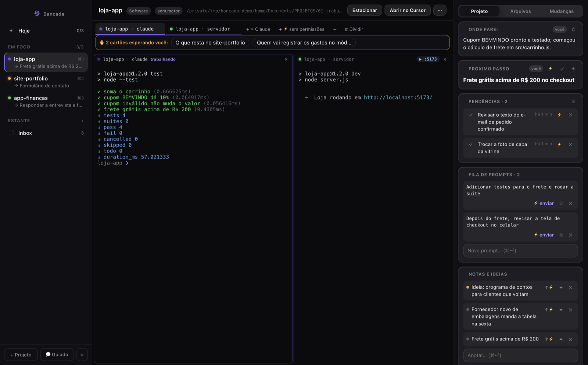

</div>

---

> **A Bancada é a evolução do PromptPad.** O PromptPad era um bloco de captura de prompts (⌥Space → escreve → fila).
> A Bancada mantém a captura rápida e as notas — e importa o `notes.json` do PromptPad sem perder nada — mas virou
> o lugar onde você trabalha com as IAs.

## Novo na 0.8

- **Instala e se atualiza sozinha** — no Windows e no Mac a Bancada procura versão nova 1× por dia (ou no botão
  **Ajustes → Atualização → Procurar atualização**), baixa em segundo plano, confere e avisa
  *"Nova versão 0.8.x — instala quando você fechar"*. Nunca interrompe o trabalho; seus projetos e ajustes continuam.
- **Mac universal** — um só `.dmg`/`.zip` para Mac com chip Apple e Mac Intel.
- **Voz no terminal** 🎤 — segure o botão (ou ⌘⇧M / Ctrl+Shift+M), fale, solte: o texto cai no terminal **sem Enter**,
  para você revisar. Funciona com o Claude, o Codex ou qualquer programa. O reconhecimento roda **no seu computador**
  (whisper.cpp), sem internet depois de baixar o modelo (≈ 550 MB, uma vez).
- **Recorte de tela e foto** 📷 — recorte uma parte da tela (⌘⇧R / Ctrl+Shift+R) ou, no celular, tire uma foto: a
  imagem vai para o terminal sem passar pela Área de Trabalho, com prévia para enviar ou cancelar.
- **Escritório fiel** — tarefas em segundo plano, agentes, monitores, terminais comuns (`npm run dev`, testes), servidor
  local e git do projeto aparecem na sala; nenhum boneco fica "pensando" sem motivo.
- **Primeira abertura para qualquer pessoa** — acha projetos com git em Documentos, Área de Trabalho, Developer,
  Projects e repos; motor "Nenhum" por padrão; **Checagem** de cada IA (instalada → conectada → plano) com o conserto.
- **Medidor de limite** do Claude ("Limite 5 h: 62% · semana: 41%"), **Relatar problema** (relatório sem conversa nem
  senha) e cartões curtos de retorno.

Tudo o que mudou, versão a versão: [CHANGELOG.md](CHANGELOG.md).

<table>
<tr>
<td>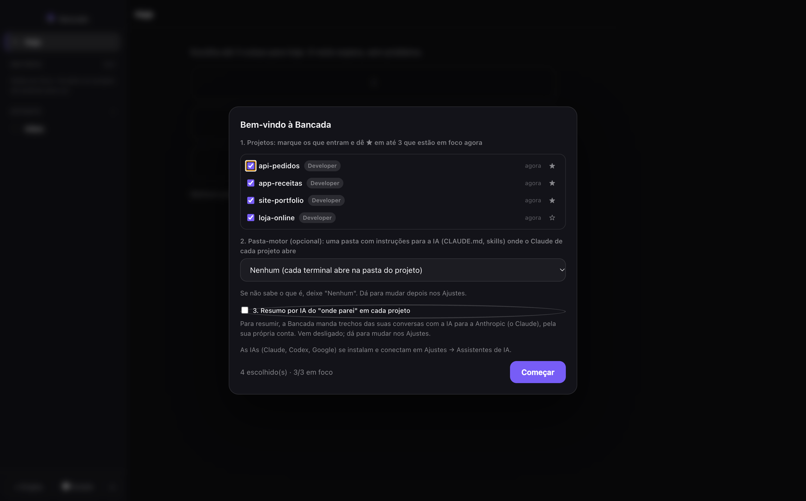</td>
<td>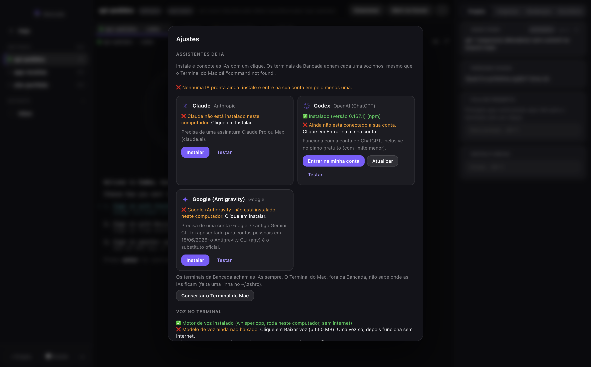</td>
</tr>
<tr><td align="center"><sub>Primeira abertura</sub></td><td align="center"><sub>Checagem das IAs</sub></td></tr>
<tr>
<td>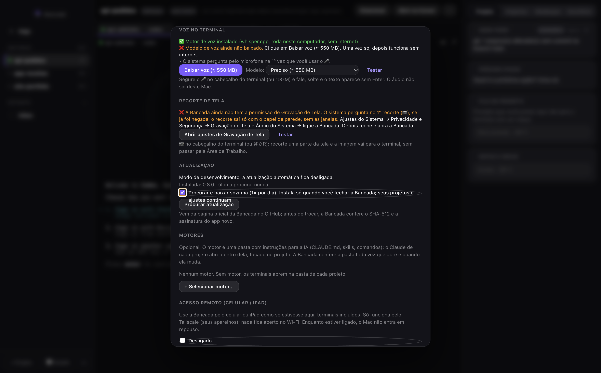</td>
<td>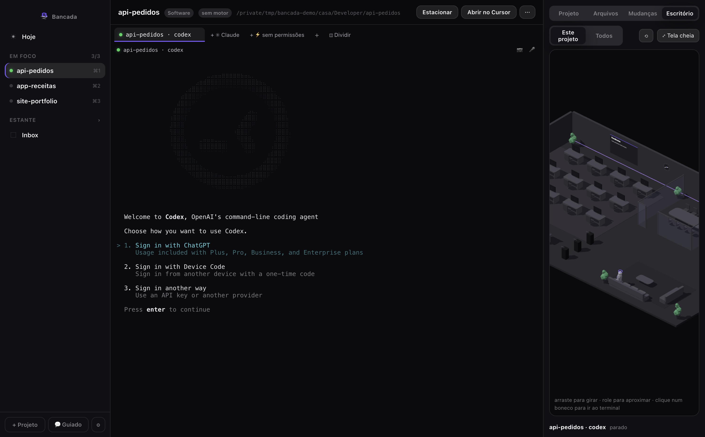</td>
</tr>
<tr><td align="center"><sub>Voz, recorte e atualização nos Ajustes</sub></td><td align="center"><sub>Escritório ao lado do terminal</sub></td></tr>
</table>

## O que ela faz

### Projetos e terminais
- **Foco e estante** — poucos projetos em foco, o resto na estante. Cada projeto com seus terminais (xterm + node-pty).
- **Onde parei / próximo passo** — lê as sessões do Claude e do Codex (só leitura, incremental) e resume em uma linha o que estava sendo feito em cada projeto.
- **Hoje** (no máximo 3 coisas) e **Inbox** para o que ainda não tem projeto; **Estacionar** guarda um projeto na estante com o registro de onde parou.
- **Painel do projeto** — onde parei, próximo passo, pendências, fila de prompts, notas e ideias, sessões recentes e comandos do motor.
- **Divisão de tela** — arraste uma aba para a lateral: até 4 painéis, de projetos diferentes, redimensionáveis, com o layout salvo.
- **Painel do projeto** — abas **Arquivos** (árvore com marcação git) e **Mudanças** (git status, diff, commit dos selecionados; nunca faz push). Arrastar um arquivo para o terminal cola o caminho.
- **Imagens para o Claude** — cole ou arraste uma imagem no terminal e ela vai como arquivo.
- **Medidor de contexto** por conversa e **prévia do localhost** em janela própria.

### Estado de cada IA
- Bolinha na aba e no projeto: **trabalhando**, **esperando você** (âmbar), **terminou**, **esperando tarefa em segundo plano**.
- Funciona por hooks do Claude Code passados com `--settings` — somam-se aos seus, nada no seu projeto é alterado.
- Aviso do macOS (e no celular) quando uma IA precisa de você; clicar leva direto ao terminal.

### O que ela está fazendo agora (v0.5)
- **Faixa de atividade** no topo de cada terminal: ferramenta em andamento e há quanto tempo, tarefas em segundo plano com a última linha da saída, agentes ativos, **quanto falta** (pelo andamento ou pela mediana das vezes anteriores) e aviso de "sem sinal".
- **Clicar no que o Claude escreve (v0.6)**: caminho de pasta abre no Finder, `.md` abre formatado na prévia, link da web abre no Safari. Funciona até com espaço no nome e com caminho quebrado em várias linhas.
- **Escritório 3D (v0.6)**: maquete que você gira e aproxima. Cada Claude é um boneco que digita, lê, pesquisa ou roda comando conforme a ferramenta, levanta a mão quando espera você e vai ao sofá quando para. Os agentes sentam na sala de reunião de vidro. Tem quadro de pendências, relógio, e uma **sala de servidores** com luzes de status (HTTP/TCP/ping saindo do Mac, sem login). Reage na hora pelos hooks do Claude Code e não gasta token nenhum. Clicar no boneco leva ao terminal.

### Responder por botões (v0.4)
- **Cartões dentro do painel do terminal.** O Claude da Bancada ganha três ferramentas (servidor MCP próprio, sem dependências):
  - `lista` — "o que resta?" vira uma lista em que cada item é marcado com um toque: **Já fiz / Adiar / Fazer agora**, com nota opcional;
  - `perguntar` — uma pergunta por vez, com opções clicáveis (teclas 1–6), texto livre, **Pular** e **Chega, quero o resumo**;
  - `pendencias` — o que você marcou "Adiar" vira pendência do projeto, num cartão próprio.
<table>
<tr>
<td>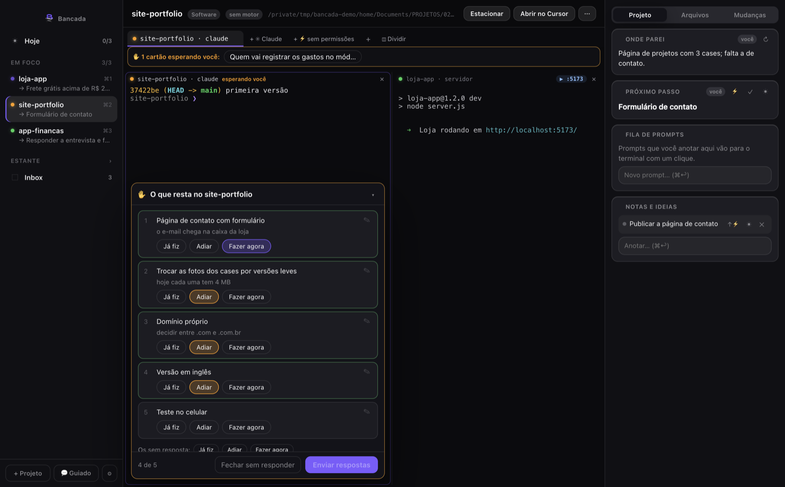</td>
<td>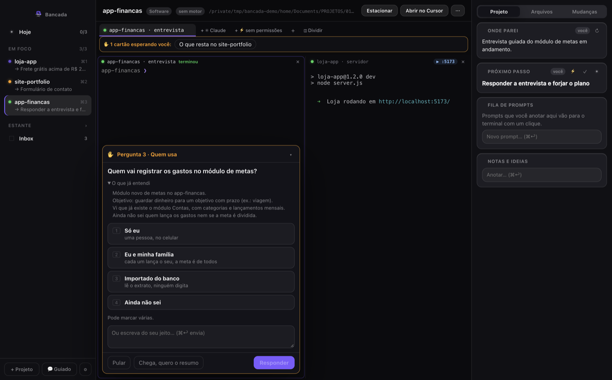</td>
</tr>
<tr><td align="center"><sub>"O que resta?" vira uma lista para marcar</sub></td><td align="center"><sub>Entrevista guiada: uma pergunta por vez</sub></td></tr>
</table>

- **💬 Novo projeto guiado** — uma entrevista estilo Akinator (`/bancada:entrevista`): cada pergunta nasce da resposta anterior, e no fim sai um resumo que qualquer pessoa conseguiria construir.

<table>
<tr>
<td>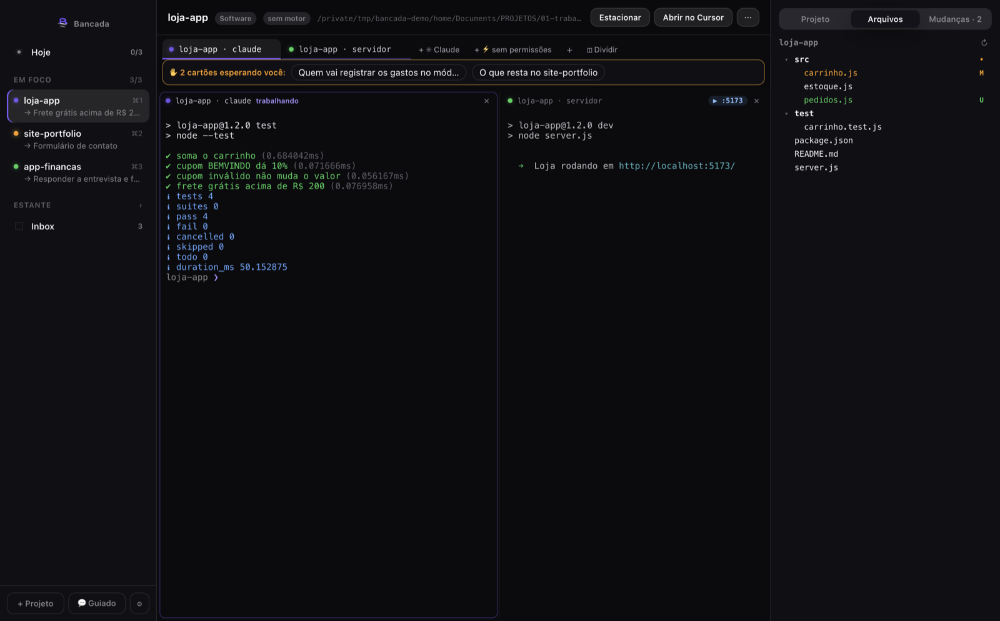</td>
<td>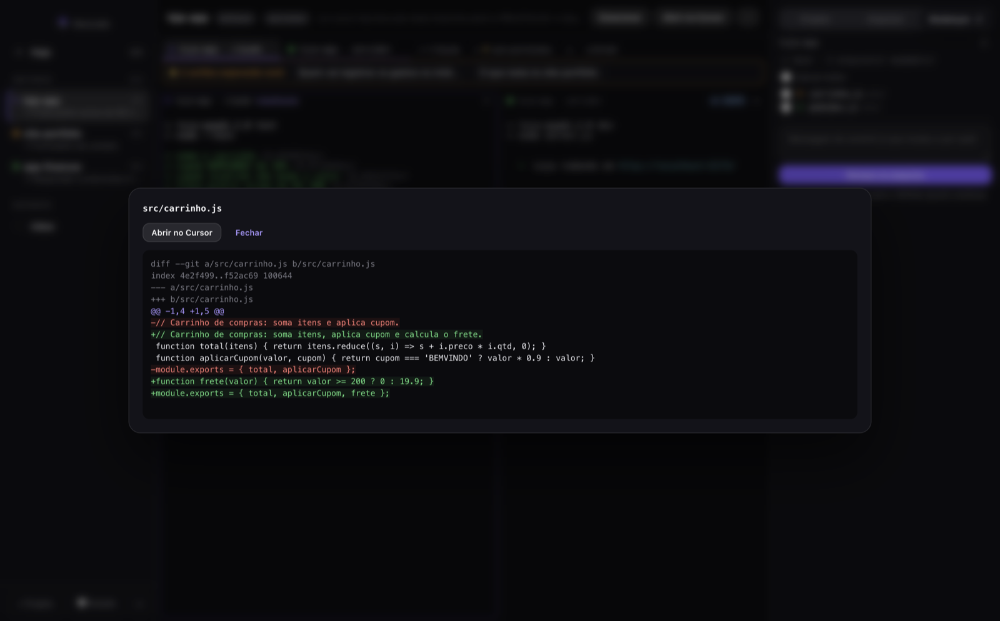</td>
</tr>
<tr><td align="center"><sub>Arquivos: árvore com marcação do git</sub></td><td align="center"><sub>Mudanças: diff e commit local</sub></td></tr>
</table>

### Assistentes de IA
- Tela **Ajustes → Assistentes de IA**: instalar, entrar, atualizar e testar Claude Code, Codex e Google (agy) pelos instaladores oficiais, sem `sudo`. Conserta o `PATH` do Terminal do Mac com backup.
- **Motores**: se você tem uma pasta-cérebro (com `CLAUDE.md`, comandos e skills), o Claude de cada projeto roda dentro dela, focado no projeto. Sem motor, ele abre na pasta do projeto.

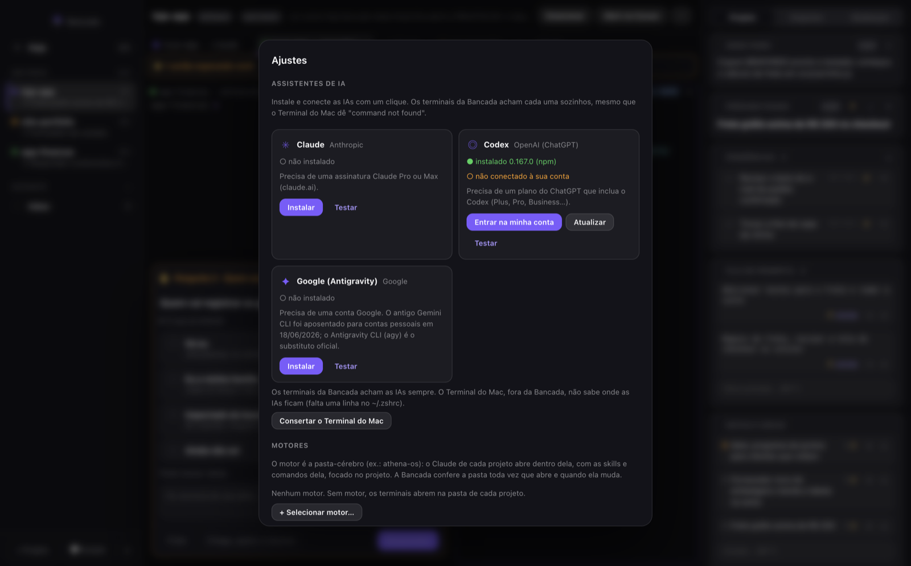

### Celular e iPad
- **Acesso remoto só pelo Tailscale** — nada na rede local, nada na internet. Pareamento por QR de uso único, token por aparelho, Host/Origin conferidos.
- Terminais, estados e cartões de pergunta funcionam no celular.

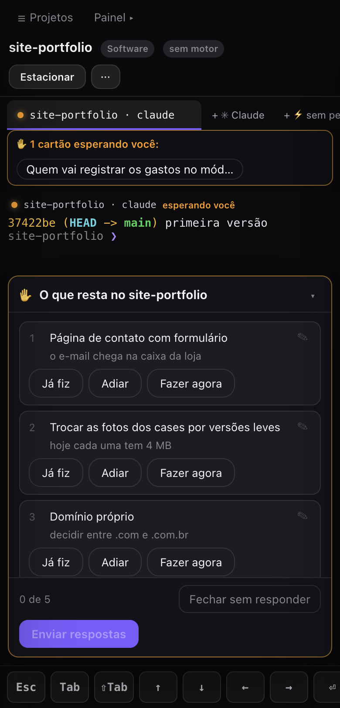

### Captura rápida (herança do PromptPad)
- **⌥Space** de qualquer lugar → anote uma nota, ideia ou prompt. `#projeto texto` cai direto no projeto.
- Resumo da manhã com as coisas de Hoje. Lembretes com hora vindos do PromptPad continuam avisando na hora (criar um lembrete com hora pela Bancada ainda não existe).

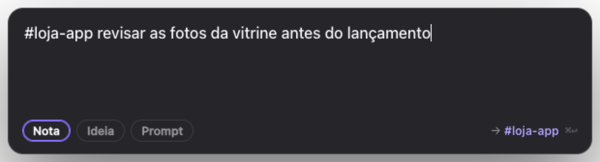

## Instalar

Baixe na página de [versões (Releases)](https://github.com/Deckoso/bancada/releases):

| Sistema | Arquivo | Primeira abertura |
|---|---|---|
| Windows 10/11 (x64) | `Bancada-Setup-<versão>-windows-x64.exe` | "O Windows protegeu o computador" → **Mais informações → Executar assim mesmo**. Instala só para o seu usuário, sem senha de administrador. Detalhes: [docs/WINDOWS.md](docs/WINDOWS.md) |
| Mac (Apple ou Intel, macOS 12+) | `Bancada-<versão>-universal-mac.dmg` | Arraste para **Aplicativos**; no 1º aviso, **Ajustes do Sistema → Privacidade e Segurança → Abrir Mesmo Assim**. Passo a passo: [docs/PASSAR-A-BANCADA.md](docs/PASSAR-A-BANCADA.md) |

Os dois instaladores não têm a assinatura paga da Microsoft/Apple; por isso o aviso na primeira vez. Para conferir o
download, compare com o `SHA256SUMS.txt` da mesma Release (`shasum -a 256 <arquivo>` no Mac, `certutil -hashfile <arquivo> SHA256` no Windows).

**Atualização:** a partir da 0.8.0 a Bancada se atualiza sozinha (ligado por padrão; desliga em **Ajustes → Atualização**).
Ela só fala com o GitHub (saída HTTPS, nenhuma porta aberta), confere a **assinatura do aviso de versão** (`latest.yml` /
`latest-mac.yml` + `.sig`, Ed25519, chave fixa no app), o SHA-512 do arquivo baixado contra esse aviso assinado e, no Mac,
também a assinatura do app novo, que precisa ter a mesma identidade do instalado. Quem tem a **0.7.x** instala a 0.8.0 por cima
uma última vez (os dados continuam); dali em diante é automático.

### Compilar (quem desenvolve, no Mac)

Node.js 20+, Xcode Command Line Tools e `cmake` (para o motor de voz).

```bash
git clone https://github.com/Deckoso/bancada.git
cd bancada
npm install          # compila node-pty e better-sqlite3 para o Electron
npm test             # testes unitários
npm run install-app  # gera (só Apple Silicon), assina localmente e instala em /Applications/Bancada.app
npm run dist:mac     # .dmg + .zip universais + latest-mac.yml + SHA256SUMS.txt em dist-mac/
npm run dist:win     # instalador do Windows em dist-win/ (dá para gerar no Mac)
npm run release:pack # junta em release/ só o que vai para a Release (não publica nada)
```

O motor de voz não vem pronto no repositório: o build do Mac **compila o whisper.cpp da fonte oficial** (tag fixa,
SHA-256 do código conferido) e o do Windows baixa o zip oficial com SHA-256 fixo — ver [build/whisper/README.md](build/whisper/README.md).
Os scripts de build param se faltar o visual (`BANCADA_AURORA_CSS` apontando para o `aurora-tokens.css`).

## Como usar

O guia completo, com todas as funções, prints e atalhos, está em **[docs/BANCADA-USO.md](docs/BANCADA-USO.md)**. O caminho mais curto:

1. **Primeira abertura:** "Estou começando" instala a IA e cria "Meu primeiro projeto"; "Já tenho meus projetos" lista as pastas com git que a Bancada achou (Documentos, Área de Trabalho, Developer, Projects, repos) para você marcar e escolher até 3 em foco (ou use **+ Projeto** para qualquer pasta).
2. **Conecte uma IA:** Ajustes → Assistentes de IA → **Instalar** e **Entrar na minha conta**.
3. **Abra um Claude** no projeto (**+ ✳︎ Claude**) e trabalhe normalmente. A bolinha mostra quando ele está trabalhando, esperando você ou terminou.
4. **Pergunte "o que resta?"** e marque a lista pelos botões; o que você adiar vira pendência.
5. **Comece algo novo com 💬 Guiado:** a IA te entrevista e no fim entrega um resumo pronto para construir.
6. **Celular:** Ajustes → Acesso remoto → Parear aparelho, com o Tailscale ligado nos dois.

| Atalho | Ação |
|---|---|
| ⌥Space | Anotar de qualquer app (`#projeto texto` manda direto para o projeto) |
| ⌘1 … ⌘5 | Projeto em foco |
| ⌘J | Hoje |
| ⌘T | Novo terminal |
| ⌘\\ | Dividir a tela |
| ⌘⇧M | Voz: segurar e falar no terminal em foco |
| ⌘⇧R | Recortar a tela para o terminal em foco |

No Windows, troque ⌘ por Ctrl (ver [docs/WINDOWS.md](docs/WINDOWS.md)).

## Privacidade e segurança

- **Tudo local.** Banco SQLite em `~/Library/Application Support/Bancada/` (Windows: `%APPDATA%\Bancada`). Nenhuma telemetria.
- **Exceção que você controla:** o resumo de "onde parei" usa o **seu** Claude (`claude -p`, modelo haiku, até 40 por dia). Trechos das conversas do projeto (Claude e Codex) vão para a Anthropic pela sua conta. Vem **desligado** em instalação nova (a primeira abertura pergunta) e muda em **Ajustes → Resumo por IA**.
- **Voz e recorte são locais:** o áudio vira texto neste computador (whisper.cpp) e é apagado; as imagens ficam em `anexos/` (apagadas depois de 14 dias). No Windows, a Ferramenta de Captura pode guardar uma cópia sua em Imagens\Capturas de Tela e no histórico da área de transferência — veja [docs/WINDOWS.md](docs/WINDOWS.md).
- **Mac — microfone e gravação de tela:** ao permitir microfone/gravação de tela para a Bancada, os programas que rodam nos terminais dela também passam a poder usar — como acontece com o Terminal do Mac. A Bancada avisa antes do 1º uso do 🎤/📷 (Continuar/Cancelar).
- **Atualização:** só saída HTTPS para o GitHub, 1× por dia ou no botão; o aviso de versão tem de vir assinado (Ed25519) e o download é conferido (SHA-512 do aviso assinado) antes de instalar; nunca aceita versão mais velha.
- **Relatar problema** copia só versões, Checagem e o registro de erros da Bancada (com senhas, tokens, cookies, e-mails e IPs da rede local apagados; caminhos fora da sua pasta pessoal viram só o nome do arquivo) — nunca terminal ou conversa.
- A ponte de perguntas não abre porta: pedidos e respostas são arquivos em pastas `0700` do seu usuário.
- Uma resposta de cartão só é colada no terminal se o Claude ainda estiver em primeiro plano nele (nunca num shell).
- Fechar um terminal ou o app encerra a sessão inteira do pty — nada fica rodando escondido.

## Arquitetura

```
app/
├── main/        # processo principal (Electron): pty, banco, hooks, sessões, ponte MCP, acesso remoto
│   ├── mcp-server.js   # servidor MCP (lista / perguntar / pendencias), roda no binário da Bancada
│   ├── asks.js         # recebe os pedidos e entrega as respostas dos cartões
│   ├── voice.js        # voz → texto (whisper.cpp local, um processo por frase, sem porta)
│   └── updater.js      # atualização: electron-updater no Windows, troca conferida (SHA-512 + assinatura) no Mac
├── preload/     # ponte segura renderer ↔ main
├── renderer/    # interface (HTML/CSS/JS, sem framework) + versão celular
└── plugin/      # plugin do Claude Code com /bancada:entrevista
test/unit/       # node:test, rodando no próprio Electron
test/e2e/        # provas do atualizador sem publicar nada (npm run test:update-win / test:update-mac)
```

## Licença

[MIT](LICENSE)

Terceiros: [whisper.cpp](https://github.com/ggml-org/whisper.cpp) (MIT, © The ggml authors) — motor de voz compilado da fonte (Mac) ou do zip oficial (Windows); [electron-updater](https://github.com/electron-userland/electron-builder) (MIT); [three.js](https://github.com/mrdoob/three.js) (MIT, © 2010–2026 three.js authors), copiado para `app/renderer/vendor/three/` com a licença original.
