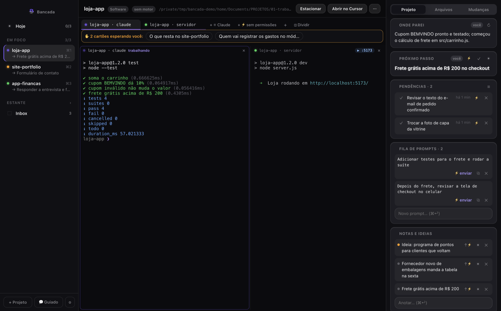
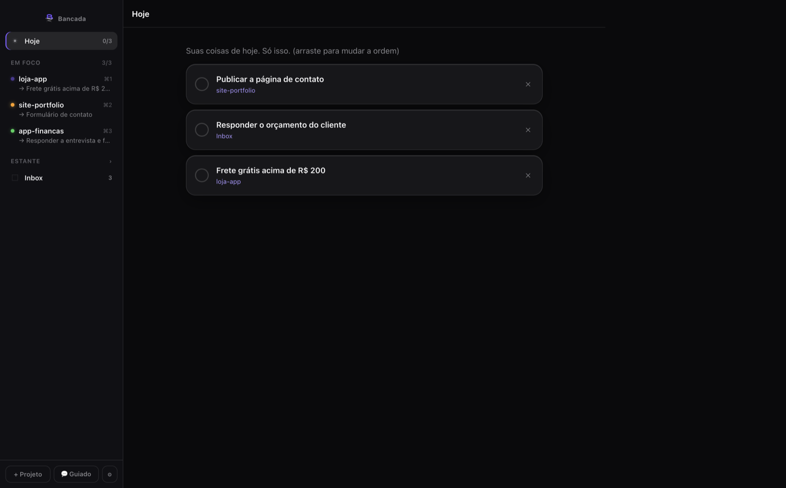
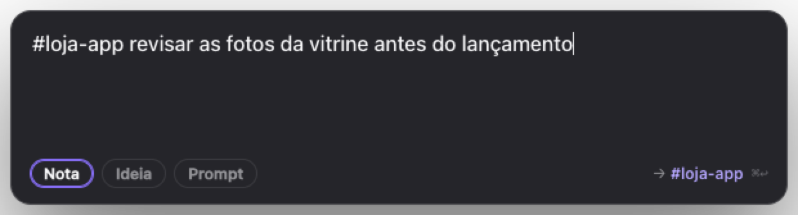
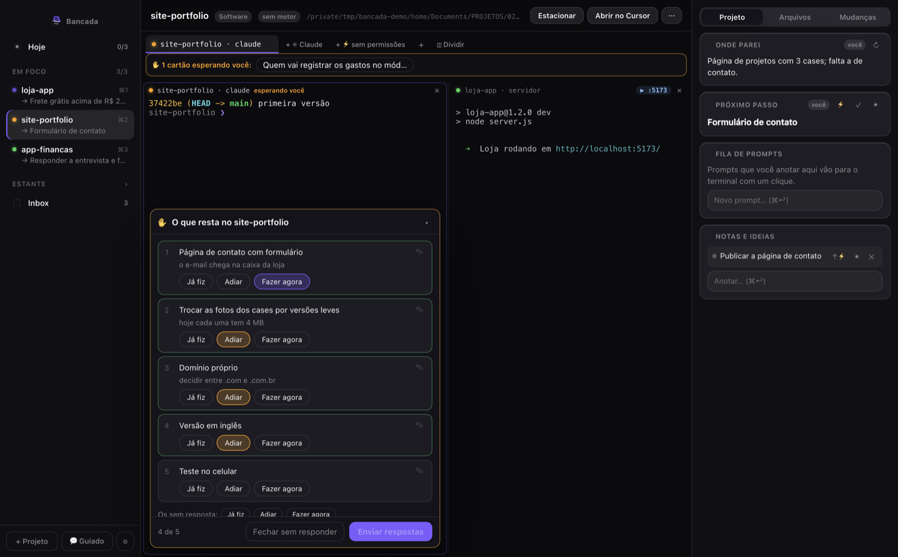
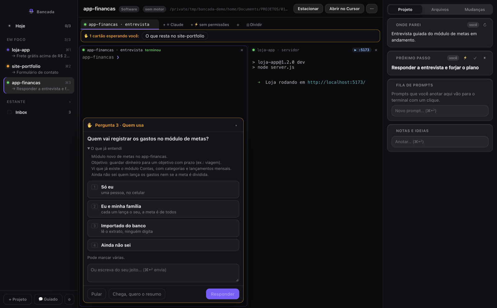
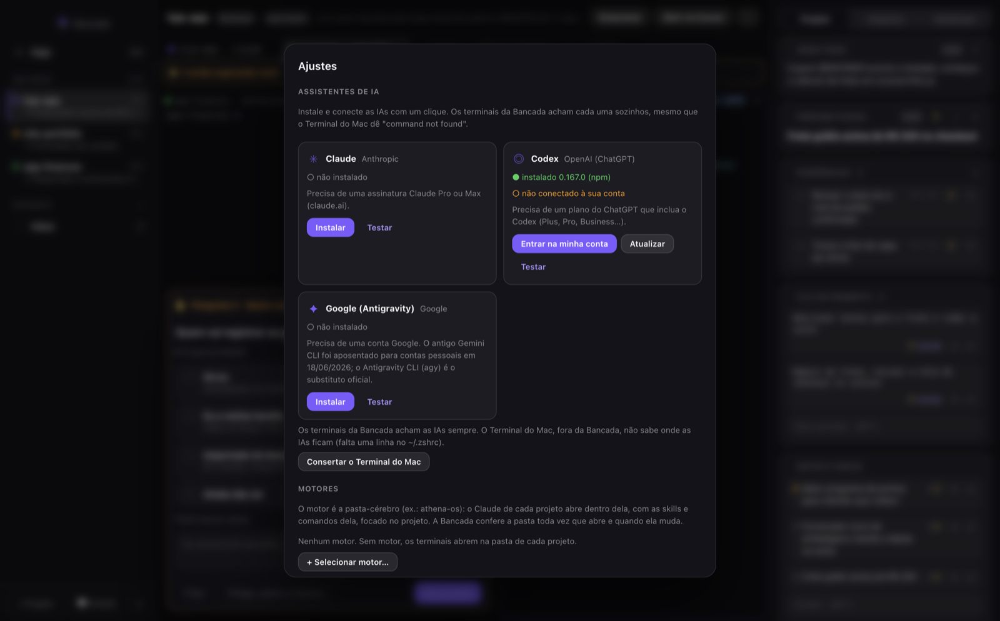
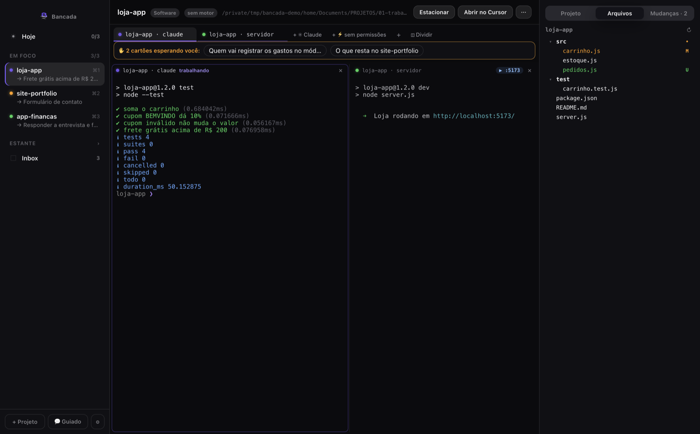
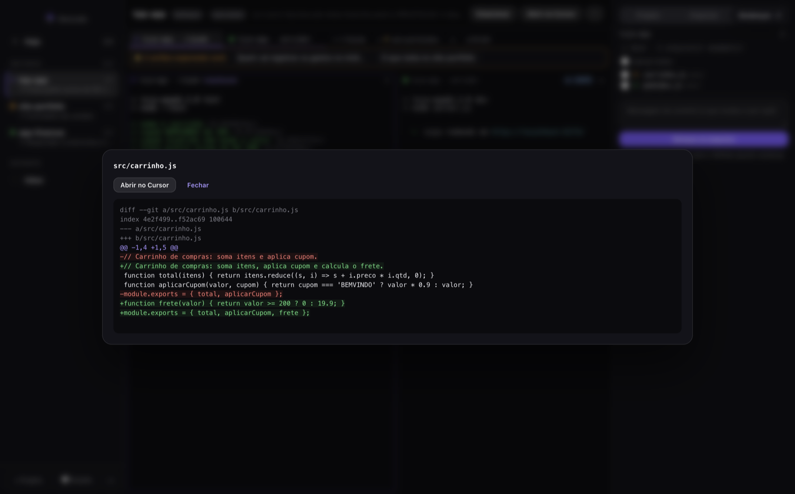
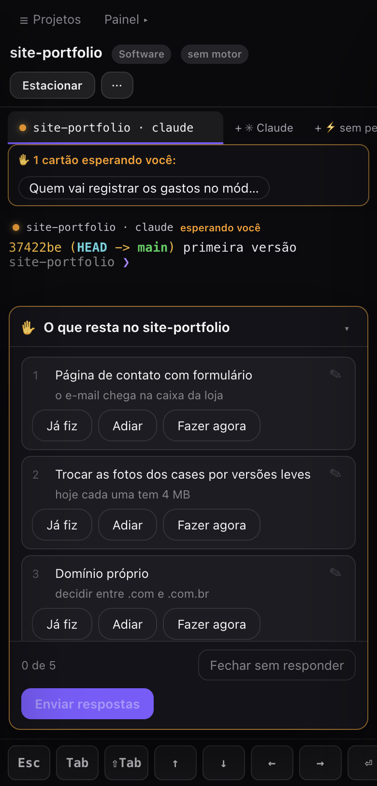

# Bancada — como usar

Guia de todas as funções, na ordem em que você encontra cada uma. Os prints usam projetos fictícios.

**Sumário:** [Primeira abertura](#primeira-abertura) · [Projetos: foco, estante, Hoje e Inbox](#projetos-foco-estante-hoje-e-inbox) · [Painel do projeto](#painel-do-projeto) · [Captura rápida (⌥Space)](#captura-rápida-space) · [Terminais e IAs](#terminais-e-ias) · [Cartões de pergunta](#cartões-de-pergunta-v04) · [Novo projeto guiado](#novo-projeto-guiado--guiado-na-barra-lateral) · [Assistentes de IA](#assistentes-de-ia-ajustes--assistentes-de-ia) · [Estado de cada Claude](#estado-de-cada-claude) · [Escritório](#escritório) · [Divisão de tela](#divisão-de-tela) · [Arquivos e Mudanças](#painel-lateral-projeto--arquivos--mudanças) · [Imagens](#imagens-para-o-claude) · [Contexto e servidor local](#contexto-e-servidor-local) · [Celular e iPad](#celular-e-ipad) · [Ajustes](#ajustes) · [Atalhos](#atalhos) · [Onde ficam os seus dados](#onde-ficam-os-seus-dados)

## Primeira abertura
1. A Bancada procura em `~/Documentos` uma pasta `PROJETOS` (ou `Projetos` / `Projects`), inclusive uma pasta abaixo, no formato `PROJETOS/<categoria>/<projeto>` — por exemplo `PROJETOS/01-trabalho/loja-app`. Ela lista o que achou; marque os projetos que quer e use ☆ para pôr até 3 **em foco**.
2. **Motor** (opcional): se você tem uma pasta-cérebro com `CLAUDE.md`, comandos e skills, escolha-a aqui. A Bancada sugere as pastas de `~/Documentos` que têm `.claude/` ou `CLAUDE.md`. Sem motor, cada terminal abre na pasta do próprio projeto.
3. **"Estou começando"** cria um primeiro projeto de exemplo e leva à tela de Assistentes de IA.
4. Se você usava o **PromptPad**, as notas de `~/Library/Application Support/PromptPad/notes.json` são importadas sem perda e sem duplicar; as de um projeto vão para o projeto de mesmo nome.

A Bancada abre sozinha quando você liga o Mac (desligue em Ajustes do macOS → Itens de início) e fica no ícone da barra de menus: **Abrir a Bancada**, **Anotar (⌥Space)**, **Sair**. Fechar a janela não encerra o app; **Sair** encerra tudo, terminais incluídos.

## Projetos: foco, estante, Hoje e Inbox

- **Em foco** (até 3 por padrão, ajustável): os projetos em que você está trabalhando agora, com atalho ⌘1, ⌘2, ⌘3. Embaixo do nome aparece o **próximo passo** de cada um, e a bolinha mostra o estado das IAs dele.
- **Estante**: o resto. Arraste um projeto entre a estante e o foco, ou use **Estacionar** no cabeçalho — antes de guardar, ela mostra o "onde parei" para você conferir. Se o foco está cheio, ela pede para estacionar um.
- **Hoje** (⌘J): no máximo 3 coisas para fazer hoje, vindas de qualquer projeto (☀︎ num item põe no Hoje). De manhã, na hora escolhida nos Ajustes, um aviso do macOS lembra as 3 (ou sugere, se você não escolheu).
- **Inbox**: o que você anotou sem projeto. Arraste um item para um projeto da barra lateral (ou use "mover para…") e troque o tipo (Nota, Ideia, Prompt, Lembrete) no seletor.
- **Lembretes:** os que têm hora (vindos do PromptPad) geram um aviso do macOS na hora certa. Ainda não dá para marcar a hora de um lembrete novo pela Bancada.
- **+ Projeto** cadastra outra pasta; **⋯** no cabeçalho tem os ajustes do projeto (nome, pastas, outros nomes, motor) e **Abrir no Cursor** abre a pasta no editor.

## Painel do projeto
Os cartões da coluna da direita podem ser arrastados para mudar a ordem e recolhidos pelo título.

| Cartão | Para quê |
|---|---|
| **Onde parei** | Uma ou duas linhas do que estava sendo feito. Vem das sessões do Claude e do Codex (só leitura) e do git; você pode escrever por cima — o que você escreveu vence até haver uma sessão mais nova. ↻ atualiza. |
| **Próximo passo** | Uma ação só. ✓ marca como feita e pergunta a próxima; ⚡ manda para o terminal; ☀︎ põe no Hoje. |
| **Pendências** | O que você marcou **Adiar** num cartão, ou o que o Claude anotou. ✓ feito, ⚡ para o terminal, ☰ pede ao Claude a lista do que resta. |
| **Fila de prompts** | Prompts que você escreveu com calma. **⚡ enviar** cola no terminal ativo (você confere e aperta Enter); depois ele desce para "enviados". |
| **Notas e ideias** | Anotações do projeto. ↑ **Virar prompt** promove uma ideia para a fila sem reescrever. |
| **Sessões recentes** | As conversas do Claude/Codex que a Bancada ligou a este projeto. ✕ tira uma sessão que não é dele. |
| **Comandos** (com motor) | Comandos e skills do motor, com busca. Clicar cola o comando no terminal, sem Enter. |

O "onde parei" pode ser resumido pela IA (Haiku, pela **sua** assinatura do Claude), 15 min depois que a sessão para, com teto de 40 chamadas por dia. Liga e desliga em Ajustes.

## Captura rápida (⌥Space)

De qualquer app, **⌥Space** abre uma caixa: escreva e aperte ⌘↩. Escolha **Nota**, **Ideia** ou **Prompt**. Começar com `#nome-do-projeto` manda direto para aquele projeto (vale também um dos "outros nomes" do projeto); sem tag, vai para o projeto aberto ou para o Inbox. Esc fecha. O atalho se troca nos Ajustes.

## Terminais e IAs
- Cada projeto tem as suas abas de terminal. **+ ✳︎ Claude** abre um Claude normal; **+ ⚡ sem permissões** abre com `--dangerously-skip-permissions` (o Claude não pede licença para agir — use só em projeto em que você confia). Nos ajustes do terminal dá para trocar de modo sem perder a conversa. **+** (⌘T) abre um terminal comum, ou Codex/Google se estiverem instalados.
- Com motor, o Claude roda dentro da pasta do motor (com as skills dele), recebe o projeto com `--add-dir` e uma instrução de foco, e a conversa fica presa àquele terminal: ao reabrir a Bancada, ele continua a mesma conversa. **Começar conversa nova** (clique duplo na aba, ou botão direito → Ajustes do terminal) inicia outra; a anterior continua no `/resume` do Claude.
- Fechar um terminal ou sair da Bancada encerra a sessão inteira daquele terminal — nada fica rodando escondido. São no máximo 12 terminais abertos.
- ⌘K limpa a tela do terminal.

## Cartões de pergunta (v0.4)
Quando o Claude de um terminal da Bancada precisa da sua decisão, aparece um **cartão dentro do painel** daquele terminal, no Mac e no celular. A bolinha fica âmbar e o macOS avisa: "tem uma lista para você marcar".

| Cartão | Como responder |
|---|---|
| **Lista** (ex.: "o que resta?") | Cada item tem **Já fiz · Adiar · Fazer agora**. O ✎ abre uma nota no item e "Os sem resposta" marca todos de uma vez. Depois, **Enviar respostas**. |
| **Pergunta** | Tocar numa opção já responde (as teclas 1–6 também). Se você escrever algo ou a pergunta aceitar várias opções, use **Responder** (⌘↩). **Pular** deixa a pergunta em aberto, e **Chega, quero o resumo** encerra a entrevista. |

- **Adiar** manda o item para o cartão **Pendências** do painel Projeto, sem aviso. Lá, ✓ marca como feito, ⚡ manda o item para o terminal e ☰ pede ao Claude a lista do que resta.
- **▾** recolhe o cartão para você ler o terminal. Se o cartão é de um terminal que não está à vista, aparece a faixa "✋ cartão esperando você"; clicar nela leva até o terminal.
- Se a conversa que perguntou foi encerrada, a resposta vai como mensagem no terminal.
- Pergunte "o que resta?" a qualquer Claude da Bancada: ele junta as pendências com o que sabe e mostra tudo em lista.

## Novo projeto guiado (💬 Guiado, na barra lateral)

1. Escreva o que quer criar, ou deixe em branco, e escolha o projeto.
2. O Claude abre e faz **uma pergunta por vez**, com palpites tirados do código do projeto, como o Akinator.
3. No fim, ele mostra o resumo para você confirmar e grava num arquivo Markdown. Se o motor tiver um comando de planejamento (ex.: `/ATHENA:tasks:forge-blueprint`), ele segue para lá; senão, explica o plano e pergunta se pode começar.
4. **Salvar e forjar depois** cria uma pendência.

Também dá para rodar a entrevista por comando:
- num terminal da Bancada: `/bancada:entrevista <pedido>`;
- fora da Bancada, copie `app/plugin/commands/entrevista.md` para os comandos do seu projeto (`.claude/commands/`). Ali ela usa a pergunta do próprio terminal, com no máximo 4 opções.

Como funciona: o Claude da Bancada abre com um servidor MCP próprio (`--mcp-config`), que roda no executável da Bancada. Os pedidos e as respostas passam por arquivos numa pasta só sua (0700). Nenhuma porta é aberta.

## Assistentes de IA (Ajustes → Assistentes de IA)

Cada IA tem um cartão que mostra se ela está instalada (e a versão) e se está conectada à sua conta.

| Botão | O que faz |
|---|---|
| **Instalar** | Roda o instalador oficial da empresa (claude.ai, chatgpt.com, antigravity.google) com o progresso na tela. Não pede a senha do Mac. Quando termina, já abre o **Entrar**. |
| **Entrar na minha conta** | Abre o login da própria IA num terminal dentro da Bancada. O navegador abre no site oficial; se pedir um código, cole com ⌘V e aperte Enter. A senha nunca passa pela Bancada. |
| **Atualizar** | `claude update` / `codex update` / `agy update`. |
| **Testar** | Confere de novo a instalação, a versão e a conta. |
| **Consertar o Terminal do Mac** | Opcional. Ajusta o `~/.zshrc` para o Terminal do Mac, fora da Bancada, também achar as IAs: faz uma cópia de segurança, remove linhas repetidas e acrescenta uma, se faltar. |

**Por que não dá mais "command not found":** os três instaladores põem o programa em `~/.local/bin`. A Bancada chama cada IA pelo caminho completo e põe essa pasta no PATH dos terminais dela, então funciona mesmo com o `.zshrc` errado.

- **Google:** o antigo Gemini CLI foi aposentado para contas pessoais em 18/06/2026. O substituto oficial é o **Antigravity CLI (`agy`)**.
- **Cada IA pede assinatura própria:** Claude Pro ou Max; plano do ChatGPT com Codex; conta Google.
- **Novo terminal (+):** abre Claude, Codex ou Google na pasta do projeto. O **◫ Dividir** também oferece Codex e Google quando estão instalados.
- **Sem motor**: o Claude abre direto na pasta do projeto, com as mesmas bolinhas de estado.
- **No celular:** só aparece o status. Instalar, conectar e consertar são só no Mac.

## Estado de cada Claude
| Bolinha | Quer dizer |
|---|---|
| roxa respirando | trabalhando |
| âmbar | **esperando você**: pediu permissão, fez uma pergunta ou tem um plano para aprovar |
| azul | **esperando tarefa**: o Claude parou, mas tem algo rodando em segundo plano (teste, build); ele volta sozinho quando acabar. Não avisa |
| verde | terminou de verdade (apaga quando você olha o terminal) |
| contorno cinza | sem notícia há 10 min (talvez você interrompeu com Esc) |

Aparece na aba, no cabeçalho do painel e no projeto da barra lateral, onde a cor mais urgente vence. Quando você não está olhando:
- **esperando você** sempre gera um aviso do macOS;
- **terminou** só gera aviso se o Claude trabalhou 20 s ou mais (contando o tempo das tarefas em segundo plano).

Clicar no aviso leva ao terminal. No celular o aviso aparece dentro da página, porque o Safari só permite notificação de site com HTTPS.

### O que ele está fazendo agora (v0.5)
Quando o Claude está trabalhando, uma faixa aparece no topo do painel do terminal, mesmo que o terminal pareça parado:
- a **ferramenta em andamento** e há quanto tempo (ex.: "Rodando · Testes · 1:12");
- cada **tarefa em segundo plano** com a **última linha da saída** dela (ex.: "Rendered 412/900 frames") e "sem saída há X" quando ela se cala;
- os **agentes** ativos: o que cada um recebeu para fazer e o que está fazendo agora;
- **quanto falta**: pelo andamento, quando a saída mostra porcentagem ou "N de M", ou pela mediana das vezes anteriores da mesma ferramenta ("costuma levar 15 min"). Na primeira vez só aparece o tempo decorrido;
- **⚠ sem sinal há X min** quando nada foi escrito por mais de 2 minutos.

Clicar na faixa abre o **Escritório**.

### Escritório
Aba **Escritório** no painel lateral (⤢ abre em tela grande): uma sala onde cada Claude é um personagem.
- **trabalhando**: na mesa, monitor aceso, balão com a ferramenta e o tempo;
- **esperando você**: em pé, balão âmbar "! esperando você";
- **tarefa em segundo plano**: na máquina, com barra de andamento;
- **agentes** entram pela porta, sentam numa mesa livre e saem quando terminam;
- sem nada acontecendo, todos no sofá.

Clicar num personagem leva ao terminal dele. **Este projeto / Todos** troca o que aparece na sala.

A faixa e o Escritório só leem arquivos locais seus: a conversa do Claude (`~/.claude/projects`) e a saída das tarefas na pasta de tarefas do próprio Claude. O histórico de durações fica em `<dados>/hooks/duracoes.json`.

Como funciona: o Claude é aberto com `--settings <dados>/hooks/settings.json`. Esses hooks **se somam** aos que você já tem (do projeto, do motor ou do seu usuário) e nada neles é alterado.

## Divisão de tela
- **◫ Dividir** (ou ⌘\\) abre outro terminal à direita ou abaixo do painel em foco.
- Arrastar uma aba para a **borda** de um painel divide a tela. Soltar no **meio** troca o terminal do painel.
- O limite é de 4 painéis, que podem ser de projetos diferentes. Para isso, abra o outro projeto e arraste a aba dele.
- A divisória se arrasta para ajustar o tamanho, e o layout volta igual quando você reabre o app.
- Botão direito na aba: "Abrir à direita / abaixo". O × do painel fecha só o painel, e o terminal continua na aba.
- Clicar num painel faz do projeto dele o projeto ativo: o cabeçalho, as abas e o painel lateral passam a seguir esse projeto.

## Painel lateral: Projeto · Arquivos · Mudanças

- **Arquivos**: a árvore do projeto (respeita o `.gitignore`), com o que mudou marcado. Clicar num arquivo mostra a prévia, com os botões **Abrir no Cursor** e **Mostrar no Finder**. Arrastar um arquivo para um painel cola o caminho dele no terminal.
- **Mudanças**: o que mudou desde o último commit. Clicar num arquivo mostra o diff. Para commitar, marque os arquivos, escreva a mensagem e use **Commitar**. É só commit local: o push continua com você.

## Imagens para o Claude
- ⌘V com um print no terminal: a imagem é salva em `anexos/` e o caminho é colado. O Claude a vê como `[Image #1]`.
- Soltar um arquivo do Finder no terminal cola o caminho dele.
- No celular, colar ou soltar uma foto envia a imagem, com limite de 10 MB.
- Anexos com mais de 14 dias são apagados quando o app abre.

## Contexto e servidor local
- O `%` no cabeçalho do painel mostra quanto da janela de contexto a conversa já usou. Fica âmbar em 75% e vermelho em 90%: nessa hora, use `/compact` ou comece uma conversa nova.
- Quando um servidor local sobe (`npm run dev`, `vite`…), o painel ganha um botão **▶ :porta**, que abre uma prévia isolada. Essa prévia só navega no próprio Mac e não aparece no celular.

## Celular e iPad

Use a Bancada pelo celular como se estivesse no Mac: terminais, estados, cartões e o painel.

1. Instale o **Tailscale** no Mac e no celular, na mesma conta (é ele que liga os aparelhos; nada fica aberto no Wi-Fi nem na internet).
2. Na Bancada: **Ajustes → Acesso remoto → Ligar** e **Parear aparelho**.
3. Leia o QR com a câmera do celular. Ele vale 5 minutos e uma vez só. No Safari, **Compartilhar → Adicionar à Tela de Início** deixa com cara de app.
4. Cada aparelho pareado aparece na lista, com **Revogar** para desconectar.

- O terminal é compartilhado: o tamanho segue quem está usando (Mac ou celular). Quando o celular encolhe um terminal, o Mac mostra "📱 No tamanho do celular · clique para voltar ao do Mac"; clicar no terminal também devolve o tamanho, e ao desconectar o celular o Mac volta sozinho. Há uma barra de teclas (Esc, Tab, setas, Enter…).
- No celular não dá para instalar IAs, abrir o Finder ou o Cursor, nem a prévia do localhost.
- Enquanto o acesso remoto estiver ligado, o Mac não entra em repouso. Desligue quando não precisar.
- Os avisos aparecem dentro da página (o Safari só deixa site mandar notificação com HTTPS).

## Ajustes
| Ajuste | O que faz |
|---|---|
| Assistentes de IA | Instalar, entrar, atualizar e testar Claude, Codex e Google; consertar o Terminal do Mac. |
| Motores | Escolher, trocar, remover e definir o motor padrão. A pasta é conferida toda vez que abre e quando muda. |
| Acesso remoto | Ligar/desligar, parear e revogar aparelhos. |
| Atalho de anotar | Padrão ⌥Space. |
| Resumo da manhã | Hora do aviso com as coisas de Hoje (padrão 09:00). |
| Projetos em foco | Máximo de 1 a 5 (padrão 3). |
| Tema | Igual ao Mac, claro ou escuro. |
| Claude sem permissões por padrão | Faz o terminal "claude" novo abrir com `--dangerously-skip-permissions`. |
| Resumo por IA do "onde parei" | Liga/desliga; mostra as chamadas de hoje e o teto. |
| Importar notas do PromptPad | Aparece se houver um `notes.json` do PromptPad. |

## Atalhos
| Atalho | Ação |
|---|---|
| ⌥Space (de qualquer app) | Anotar |
| ⌘1 … ⌘5 | Ir para o projeto em foco |
| ⌘J | Hoje |
| ⌘T | Novo terminal |
| ⌘\\ | Dividir a tela |
| ⌘K | Limpar o terminal |
| ⌘↩ | Salvar uma anotação / responder um cartão com texto |
| Clique duplo na aba | Ajustes do terminal (nome, modo com ou sem permissões, conversa nova) |
| 1–6 | Escolher a opção de um cartão de pergunta |
| Esc | Fechar a caixa de anotar |

## Onde ficam os seus dados
- Tudo fica no seu Mac, em `~/Library/Application Support/Bancada/`: o banco (`bancada.db`, SQLite), os hooks, a pasta dos cartões (`perguntas/`, permissão 0700) e os anexos de imagem.
- A Bancada não manda nada para fora. As únicas saídas de rede são as que você pede: instalar uma IA (instalador oficial), a própria IA conversando com o servidor dela, e o acesso remoto pelo Tailscale, se você ligar.
- As sessões do Claude (`~/.claude/projects`) e do Codex (`~/.codex/sessions`) são **só lidas**, para o "onde parei".
