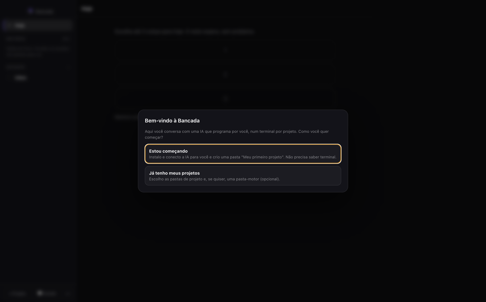
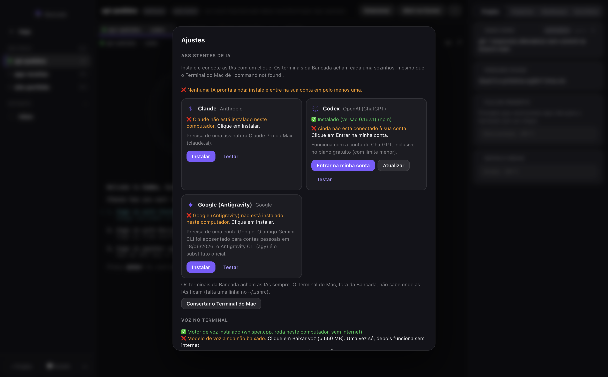

# Passar a Bancada para outra pessoa (0.8)

## 1. O arquivo

O jeito mais simples é mandar o link da página de [versões (Releases)](https://github.com/Deckoso/bancada/releases).
Lá estão:

| Para | Arquivo |
|---|---|
| Mac com chip Apple (M1 ou mais novo) **ou** Mac Intel, macOS 12 ou mais novo | `Bancada-<versão>-universal-mac.dmg` |
| Windows 10/11 de 64 bits | `Bancada-Setup-<versão>-windows-x64.exe` (guia: [WINDOWS.md](WINDOWS.md)) |

Um arquivo só serve para os dois tipos de Mac (é "universal"). Para conferir que o arquivo é o publicado, compare o
SHA-256 com o `SHA256SUMS.txt` da mesma página (`shasum -a 256 Bancada-…-universal-mac.dmg` no Terminal).

**Nada pessoal vai junto:** notas, projetos, contas e conversas ficam na pasta de dados de cada computador, fora do app.

> Quem desenvolve gera os mesmos arquivos com `npm run dist:mac` / `npm run dist:win` e junta com `npm run release:pack`
> (pasta `release/`). O antigo `npm run share` ainda gera um `.zip` só para Mac com chip Apple.

## 2. Primeira abertura no Mac da pessoa

1. Dê dois cliques no `.dmg` e arraste a **Bancada** para a pasta **Aplicativos**. (Abra sempre a de Aplicativos, não a de
   dentro do `.dmg`: só ela consegue se atualizar sozinha.)
2. Abra a Bancada. O Mac avisa que não conseguiu verificar o desenvolvedor: clique em **OK** (ou **Concluído**).
3. Abra **Ajustes do Sistema → Privacidade e Segurança**, desça até a mensagem *"A Bancada foi bloqueada…"* e clique em
   **Abrir Mesmo Assim**. Confirme com a senha ou o Touch ID e, no aviso seguinte, **Abrir**.
4. Pronto. Das próximas vezes, abre direto — inclusive depois das atualizações automáticas.

**Por que esse passo existe:** o app é assinado por nós, não pela Apple. Pular esse passo exige uma conta de desenvolvedor
Apple (US$ 99/ano) para "notarizar" o app. A assinatura é a mesma em todas as versões: o Mac reconhece a
Bancada atualizada como o mesmo app, então as permissões (microfone, gravação de tela) não precisam ser dadas de novo a
cada versão. (A Gravação de Tela, no macOS 15 ou mais novo, ainda é reconfirmada pelo próprio sistema de tempos em tempos.)

**Permissões que o Mac pode pedir (só quando a função é usada):**
- **Microfone** — no 1º uso do 🎤. Negou sem querer? **Ajustes do Sistema → Privacidade e Segurança → Microfone → ligue a Bancada.**
- **Gravação de Tela e Áudio do Sistema** — no 1º recorte de tela (📷). Sem ela o recorte sai só com o papel de parede.
  **Ajustes do Sistema → Privacidade e Segurança → Gravação de Tela e Áudio do Sistema → ligue a Bancada**, depois feche e
  abra a Bancada. Os Ajustes da Bancada mostram se está liberado e têm um botão que abre essa tela.

> **Importante:** ao permitir microfone/gravação de tela para a Bancada, os programas que rodam nos terminais dela também
> passam a poder usar — como acontece com o Terminal do Mac. Antes do 1º uso do 🎤 ou do 📷 a Bancada mostra esse aviso
> (Continuar/Cancelar). Se não quiser isso, não libere (ou tire depois em Ajustes do Sistema → Privacidade e Segurança).

## 3. Dentro da Bancada

1. Escolha **"Estou começando"** (quem já programa escolhe **"Já tenho meus projetos"** e marca as pastas com git que a
   Bancada achou; o motor fica em "Nenhum").
2. No cartão da IA que a pessoa assina, clique em **Instalar** e depois em **Entrar na minha conta**. O navegador abre no
   site oficial: entrar e autorizar. Sem assinatura do Claude, o **Codex** funciona com a conta grátis do ChatGPT.
3. Clique em **Continuar**. A Bancada cria **Documentos › Bancada › Meu primeiro projeto**, abre a IA nessa pasta e mostra
   a **Checagem** (✅/❌ por IA: instalada → conectada → plano, com o que fazer em cada ❌).
4. Na primeira vez, a IA pergunta em inglês se você confia na pasta:
   - **Claude:** seta ↓ até "Yes, I trust this folder" e Enter;
   - **Codex:** Enter.
5. Escreva o pedido em português, por exemplo: *"crie uma página com um relógio grande e me mostre como abrir"*.
   Ou segure o 🎤 e fale; ou clique em 📷 para mostrar um pedaço da tela.

## 4. Atualizações

A Bancada procura versão nova 1× por dia, baixa em segundo plano, confere e mostra na lateral
*"Nova versão 0.8.x — instala quando você fechar"*. Ao sair da Bancada (**Bancada → Sair** ou ⌘Q), ela troca o app e abre
de novo, já atualizada. Para procurar na hora ou desligar: **Ajustes → Atualização**.

Se aparecer *"Esta cópia não se atualiza sozinha"*: a Bancada está fora de Aplicativos (ou é uma cópia antiga, de antes da
0.8). Baixe o `.dmg` novo pela página de versões e arraste por cima da antiga — os dados continuam.

## Se algo der errado

| Sintoma | O que fazer |
|---|---|
| "a Bancada está danificada" | O arquivo foi copiado por um caminho que estragou a assinatura. Baixe de novo pela página de versões. |
| Instalar uma IA falhou | Normalmente é falta de internet. O registro aparece no próprio cartão; clique em **Testar** e tente de novo. |
| "não conectado" depois do login | Clique em **Testar**. Se continuar, **Entrar na minha conta** de novo. Confira se a assinatura da IA está ativa. |
| A IA fechou na pergunta de confiança | Aperte Enter no terminal para reabrir e escolha a opção de confiar. |
| Algo travou | **Ajustes → Problemas → Relatar problema** copia um relatório curto (sem conversa nem senha) para mandar a quem te passou a Bancada. |
